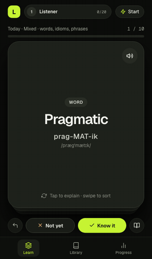
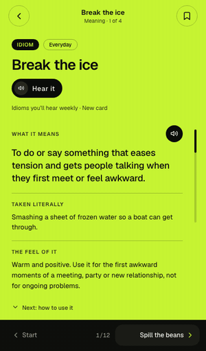
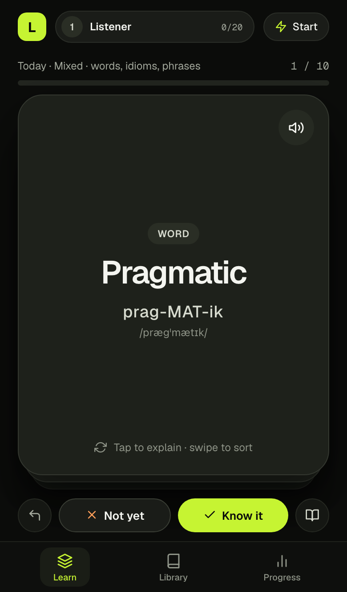
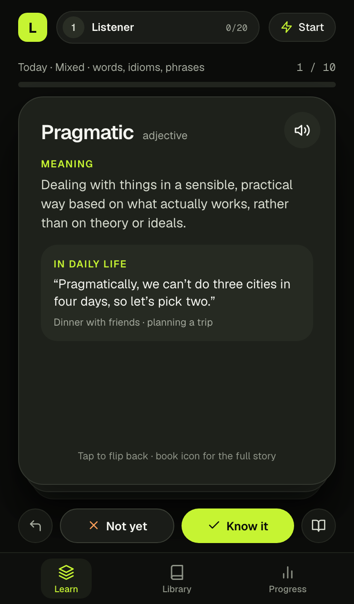
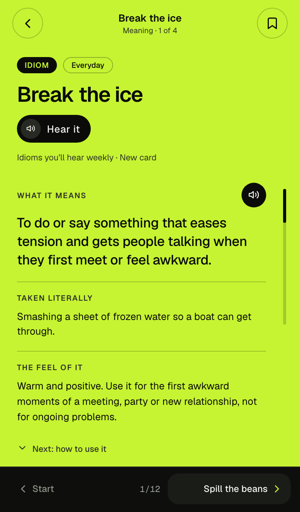
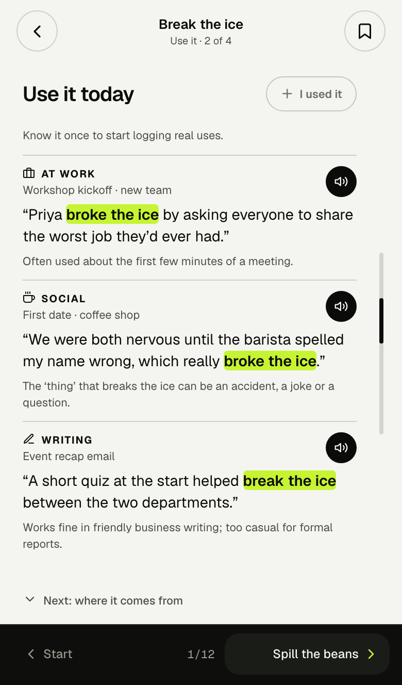
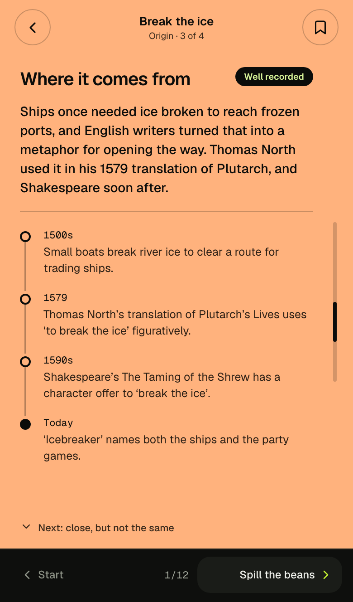
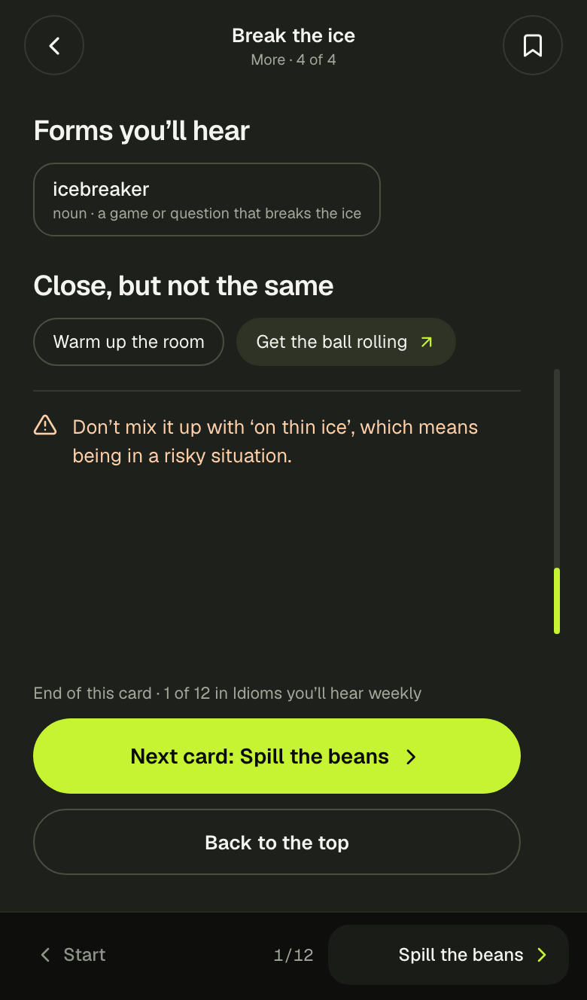
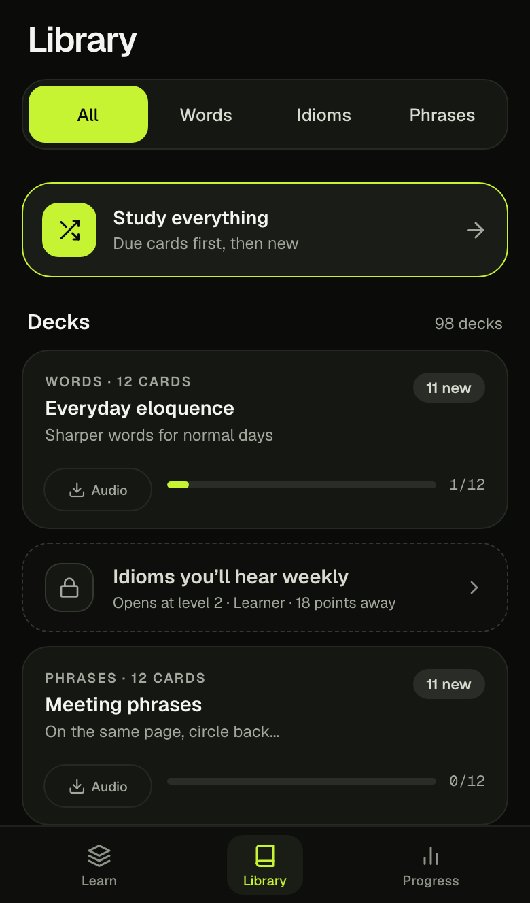
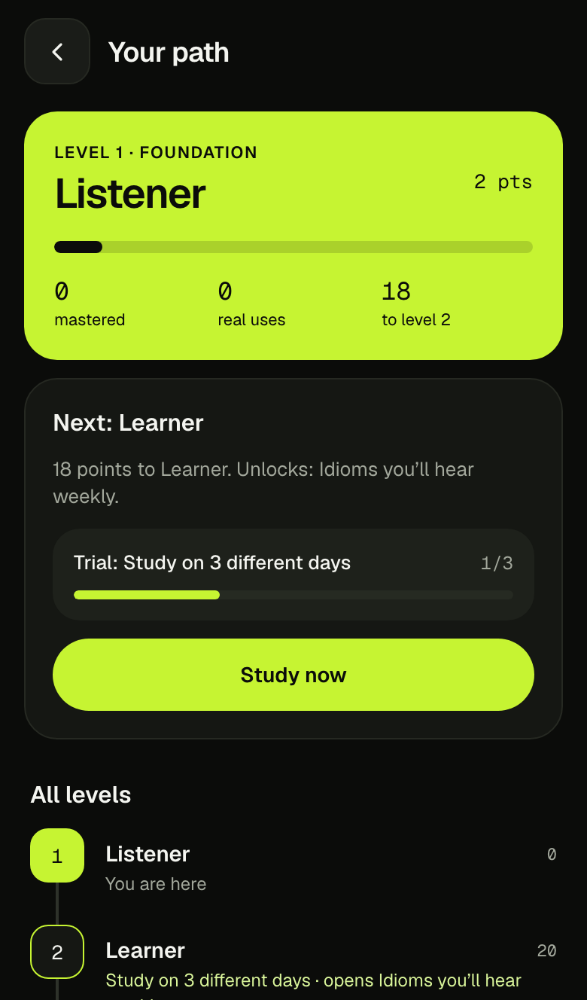

<div align="center">


# Lexicard

**Swipe to learn the words, idioms and phrases people actually use.**

Every card shows what a term means, how to use it at work, with friends and in writing,
and where it comes from, with an honest *Well recorded / Likely / Myth* tag on each origin story.

[](https://shivarajbakale.github.io/lexicard/)
[](https://github.com/shivarajbakale/lexicard/actions/workflows/deploy.yml)


**[Open the app →](https://shivarajbakale.github.io/lexicard/)** · works in any browser, installs to your home screen

<br/>


&nbsp;&nbsp;&nbsp;


</div>

## Features

- **Swipe to sort.** Right if you know it, left if you don't. Tap to flip, undo with one tap.
- **2,051 cards in 98 decks:** 1,024 words, 524 idioms and 503 phrases, from *pragmatic* to *spill the beans*.
- **Four slides per card,** paged like reels: Meaning, Use it (work, social, writing), Origin, and More.
- **Honest origins.** Each origin story has a timeline and a confidence tag, so folk etymology is called out as a myth.
- **Spaced repetition** with Leitner boxes (1, 2, 4, 8 and 16 days).
- **Ten levels,** from Listener to Lexicon. Points only come from real progress and from logging real-world uses ("I used it").
  Levels unlock decks, streak freezes, an origin quiz, a weekly recap, challenge mode and a card style.
- **Audio** for the original decks, recorded locally with [Kokoro-82M](https://huggingface.co/hexgrad/Kokoro-82M).
- **Installable and offline.** A PWA with a service worker that precaches the whole app. Progress stays on your device.

## Screenshots

<table>
  <tr>
    <td align="center"><br/><sub>Learn</sub></td>
    <td align="center"><br/><sub>Flip for the meaning</sub></td>
    <td align="center"><br/><sub>Meaning</sub></td>
    <td align="center"><br/><sub>Use it</sub></td>
  </tr>
  <tr>
    <td align="center"><br/><sub>Origin</sub></td>
    <td align="center"><br/><sub>Forms and look-alikes</sub></td>
    <td align="center"><br/><sub>Library</sub></td>
    <td align="center"><br/><sub>Your path</sub></td>
  </tr>
</table>

## Tech stack

| | |
| --- | --- |
| App | [Expo](https://expo.dev) SDK 58, React Native 0.88, React Native Web, Expo Router |
| Motion | Reanimated 4, Gesture Handler 3 |
| State | zustand, persisted on the device (localStorage on web) |
| Audio | Kokoro-82M (generated offline), expo-audio |
| Content | Node scripts and the MiniMax API, with schema validation on every card |
| Hosting | GitHub Pages, deployed by GitHub Actions on every push to `main` |

## Run it

```sh
git clone https://github.com/shivarajbakale/lexicard.git
cd lexicard
npm install
npm run web            # dev server at http://localhost:8081
```

Keyboard on web: `←` still learning · `→` know it · `Space` flip · `Enter` details · `Z` undo · `S` say it.

Checks before you push:

```sh
npm run typecheck
npm run lint
npm run check:decks
```

## Project layout

```text
src/app/          screens (Expo Router): Learn, Library, Progress, card pages, levels, quiz, challenge
src/components/   deck cards, speaker, level chips, the "I used it" sheet
src/lib/          store, spaced repetition (srs.ts), levels, audio, types
src/data/decks/   one JSON file per deck (generated/ holds the generated ones)
scripts/          deck checks, content pipeline, audio, PWA build
```

## Content

All cards live in JSON under `src/data/decks/` — one file per deck. The schema is
`src/lib/types.ts`. To add a deck, drop a JSON file there and add it to
`src/data/index.ts`, then run:

```sh
npm run check:decks    # validates every card (ids, 3 uses, highlights, origin)
```

Card ids are the slug of the term, so review history survives edits to a card.

## Generating more content

`npm run content` writes new word, idiom and phrase cards with MiniMax, using your own API key (no other AI service
is involved). It runs on your machine, checks every card against the schema, and can be rerun to resume.

```sh
export MINIMAX_API_KEY=...                      # never commit this
export MINIMAX_MODEL=MiniMax-M2.7-highspeed     # optional; this is the default
npm run content -- --pdf ~/path/to/word-book.pdf --words 1000 --idioms 500 --phrases 500
```

What it does:

1. Reads only the headwords from the PDF's index (`scripts/content/extract-pdf-words.py`, run through `uv`).
   No definitions or example sentences are taken from the book.
2. Fetches idiom and phrase titles from Wiktionary's category lists (`scripts/content/fetch-idioms.mjs`).
3. Has the model score those for how common and polite they are, and keeps the best.
4. Writes a full card for every term (meaning, three uses, origin with an honest confidence label), validates it,
   and retries with the errors when a card doesn't pass.
5. Groups the cards into topic decks under `src/data/decks/generated/` and registers them in `src/data/generated.ts`.

Working files (PDF headwords, the Wiktionary lists, the per-card cache) live in `content/`, which is not committed.
Origins are model output: spot-check them before shipping. Audio for new cards comes from
`node scripts/generate-audio.mjs`.

## Spaced repetition

Leitner boxes 1–5 with intervals of 1, 2, 4, 8 and 16 days. Swipe right moves a card
up a box; swipe left sends it back to box 1 and replays it once at the end of the
session. Progress is stored on the device (localStorage on web).

## Levels

Ten levels, from Listener to Lexicon (`src/lib/levels.ts`). Points come only from real progress:

- a card earns points the first time it reaches each box (1, 2, 3, then 4 for Box 5: 10 per mastered card);
  forgetting a card never takes points away, because only the best box counts;
- logging a real use on a card's detail page ("I used it") earns 3 points per setting (work, social, writing)
  and moves the card up a box. It unlocks once the card has left Box 1.

Practice-mode swipes keep the streak alive but never move boxes, so they earn nothing. A level opens when you have
its points and have passed its trial (for example "Master 5 cards" or "Use 3 different terms at work"). Levels never
go down. Each level unlocks something: extra decks (Idioms you'll hear weekly at 2, Polite pushback at 4, Strange
origins at 5), streak freezes (3, 6, 9), the Origin quiz (5), the weekly recap (6), Challenge mode (7), the Ink card
style (8), and a star every 150 points after level 10. Decks you already have history in stay open.

The level-up screen shows once per level, at the end of a session or right after logging a use. All of it is
computed from on-device state; stored data migrated to version 1 (best boxes backfilled, existing learners start
at the level they've already earned).

## Audio

The original 72 cards ship with pre-generated MP3s (term, meaning and the three example sentences) made locally with
[Kokoro-82M](https://huggingface.co/hexgrad/Kokoro-82M) (Apache-2.0). Voice, accent, speed and bitrate are in
`audio.config.json`.

One-time setup:

```sh
brew install espeak-ng ffmpeg
uv venv --python 3.12 .venv-kokoro
VIRTUAL_ENV=.venv-kokoro uv pip install kokoro soundfile pip \
  "en_core_web_sm @ https://github.com/explosion/spacy-models/releases/download/en_core_web_sm-3.8.0/en_core_web_sm-3.8.0-py3-none-any.whl"
```

Then `node scripts/generate-audio.mjs` (add `--dry-run` to preview, `--verify` to transcribe each clip with the
`speech` CLI and flag mismatches). Only changed clips are regenerated.

## Build & deploy

```sh
BASE_URL=/lexicard npm run build:web   # expo export + PWA post-processing into dist/
BASE_URL=/lexicard npm run preview:web # serve dist like GitHub Pages at localhost:4173/lexicard/
```

`scripts/pwa.mjs` adds the web manifest, a service worker that precaches the whole
build, `404.html` for deep links, and `.nojekyll`.

GitHub Pages: push to `main`, then in **Settings → Pages** set **Source** to
**GitHub Actions**. `.github/workflows/deploy.yml` builds with
`BASE_URL=/<repo-name>` and publishes `dist/`. The site appears at
`https://<user>.github.io/<repo-name>/`.

## Credits

- Idiom and phrase titles come from [Wiktionary](https://en.wiktionary.org/) category lists (CC BY-SA 4.0). Only the titles are used.
- Voices: [Kokoro-82M](https://huggingface.co/hexgrad/Kokoro-82M) (Apache-2.0).
- Fonts: [Geist and Geist Mono](https://vercel.com/font) (SIL Open Font License).

## License

[MIT](LICENSE)
